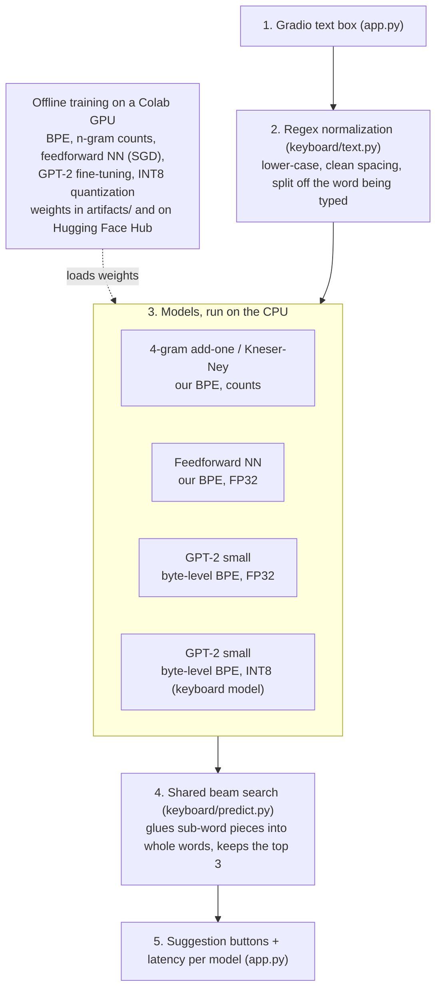

# Smart Keyboard: next-word prediction

SWE015 Introduction to Large Language Models, homework "Building an Intelligent Application", **Use Case 5**.

An English keyboard that suggests the next three words while you type. The same task is solved by a ladder of
models of increasing power, all trained on the WikiText-2 training split and evaluated on its test split:

| Ladder step | Model | Area |
| --- | --- | --- |
| Classical baseline | 4-gram language models over our own BPE pieces, with add-one and with interpolated Kneser-Ney smoothing | B |
| Neural network | Feedforward neural language model (Bengio et al., 2003), trained from scratch with SGD and backpropagation | A |
| Transformer | GPT-2 small (124M parameters), fine-tuned on the training split | C |
| Quantized Transformer | The fine-tuned GPT-2 with dynamic INT8 quantization; **this is the model the app runs** | D |

## Quick start

Needs Python 3.10 or newer.

```bash
python -m venv .venv && source .venv/bin/activate      # Windows: .venv\Scripts\activate
pip install -r requirements.txt
python app.py                     # downloads the trained weights (first run only), then opens the app
```

Open http://127.0.0.1:7860, type some text, and click a suggestion to insert it. Each column shows one model's
top-3 next words and how long it took. Add `--share` for a public link (for example from Google Colab).

The weights are not in git. They are in the Hugging Face model repo
[`Waxech/smart-keyboard-models`](https://huggingface.co/Waxech/smart-keyboard-models) (`models_repo` in
`keyboard/config.py`); use `--models-repo USER/NAME` for another one.

## Train everything yourself

```bash
python -m keyboard.cli all          # prepare, bpe, ngram, ffnn, gpt2, quantize, evaluate
```

A GPU is used automatically when available (GPT-2 fine-tuning is slow on a CPU). The easiest way is the Colab
notebook [`notebooks/colab.ipynb`](notebooks/colab.ipynb), which runs each step on a free T4 GPU, saves the
weights to Google Drive and uploads them to the Hugging Face Hub.

Each step can also run on its own, and every setting in `keyboard/config.py` can be overridden:

```bash
python -m keyboard.cli prepare                    # data/{train,valid,test}.txt
python -m keyboard.cli bpe                        # artifacts/bpe/tokenizer.json
python -m keyboard.cli ngram                      # artifacts/ngram/ngram4.npz
python -m keyboard.cli ffnn --ffnn-epochs 10      # artifacts/ffnn/
python -m keyboard.cli gpt2 --gpt2-epochs 1       # artifacts/gpt2-finetuned/
python -m keyboard.cli quantize                   # artifacts/gpt2-int8/
python -m keyboard.cli evaluate                   # results/results.md and results/results.json
python -m keyboard.cli upload                     # weights -> Hugging Face Hub, after `huggingface-cli login`
```

## Architecture



All models predict sub-word pieces. `keyboard/predict.py` turns any of them into a keyboard with the same small
beam search, scoring a word as P(piece 1) · P(piece 2 | piece 1) · … · P(the next piece starts a new word).
If the text ends in the middle of a word, only completions of that word are suggested.

## Technique map

| Component | Technique | Area | File |
| --- | --- | --- | --- |
| Text cleaning | Regex normalization (WikiText artifacts, lower-casing, whitespace), regex word tokenizer | B | `keyboard/text.py` |
| Our tokenizer | BPE trained on the training split (8,000 pieces) | B | `keyboard/bpe.py` |
| Classical baseline | n-gram LMs, add-one and interpolated Kneser-Ney smoothing, perplexity | B | `keyboard/ngram.py` |
| Neural network | Feedforward network with an embedding layer, SGD + backpropagation, dropout | A | `keyboard/ffnn.py` |
| Transformer | GPT-style decoder (masked self-attention) fine-tuned on our corpus; byte-level BPE tokenizer | C | `keyboard/gpt2.py` |
| Efficient model | Dynamic INT8 quantization with per-channel weights and SmoothQuant | D | `keyboard/quantize.py` |
| Benchmark | Size, latency and accuracy of every model on the same test set | D | `keyboard/evaluate.py` |

## Evaluation

`python -m keyboard.cli evaluate` measures every model on the same held-out test split and writes
`results/results.md`:

- **Perplexity per word**: exp(total negative log-likelihood of the test text / number of words). The models use
  different tokenizers, so the NLL of the whole text is divided by the same word count for all of them.
- **Top-3 next-word accuracy**: 1,000 random word positions of the test text, the same for every model
  (saved in `results/eval_positions.json`).
- **Size**: bytes on disk of the saved model.
- **Latency**: wall-clock time of one suggestion call on the CPU, averaged over those 1,000 calls. The CPU is
  written under the table.

## Results

Run `python -m keyboard.cli evaluate`; the table is written to [`results/results.md`](results/results.md).

## Notes on the implementation

- **n-grams** (`keyboard/ngram.py`): every n-gram of token ids is packed into one 64-bit integer and stored in a
  sorted numpy array, so counting is `np.unique` and lookup is `np.searchsorted`. Kneser-Ney uses continuation
  counts for the lower orders and the discount d = n1 / (n1 + 2 n2) for each order.
- **Feedforward network** (`keyboard/ffnn.py`): previous 5 pieces → 128-dim embeddings → 512 tanh units →
  dropout 0.3 → softmax over 8,000 pieces; SGD with momentum 0.9, learning rate halved when the validation
  perplexity stops improving.
- **GPT-2** (`keyboard/gpt2.py`): one epoch of causal-LM fine-tuning, AdamW (lr 5e-5), blocks of 256 tokens,
  mixed precision on the GPU.
- **Quantization** (`keyboard/quantize.py`): Hugging Face GPT-2 implements its linear layers as `Conv1D`, which
  PyTorch's dynamic quantizer ignores, so they are converted to equivalent `nn.Linear` layers first. Plain
  dynamic quantization then failed: it quantizes each layer's input with one scale per tensor, and GPT-2 has a
  few hidden dimensions with much larger values than the rest (outlier features), so the small values were
  rounded away (first run: test perplexity per word 40 in FP32, 27,844 in INT8). The quantizer therefore uses
  per-channel INT8 weights and SmoothQuant (Xiao et al., 2023), which divides each input channel by
  s = max|X|^a / max|W|^(1-a), folds the division into the LayerNorm (or value projection) before the layer and
  multiplies the weights by s, so the FP32 model is unchanged but the outliers move into the weights. If the
  validation perplexity is still more than 2% above FP32, the layers with the largest INT8 error stay in FP32.
  Every setting it tried, with its validation perplexity, is saved in `artifacts/gpt2-int8/quantization.json`.

## Tests

```bash
pytest -q
```

The tests run the whole pipeline on a small synthetic corpus with a tiny GPT-2 built from scratch, so they need
no downloads and finish in about a minute.

## Data and models

- WikiText-2 (raw): S. Merity, C. Xiong, J. Bradbury, R. Socher, *Pointer Sentinel Mixture Models*, 2016
  ([arXiv:1609.07843](https://arxiv.org/abs/1609.07843)), CC BY-SA, via the Hugging Face dataset
  `Salesforce/wikitext` (`wikitext-2-raw-v1`).
- GPT-2 small: A. Radford et al., *Language Models are Unsupervised Multitask Learners*, OpenAI 2019, Hugging Face
  model `gpt2`.
- Y. Bengio et al., *A Neural Probabilistic Language Model*, JMLR 2003.
- G. Xiao et al., *SmoothQuant: Accurate and Efficient Post-Training Quantization for Large Language Models*,
  ICML 2023 ([arXiv:2211.10438](https://arxiv.org/abs/2211.10438)).
- D. Jurafsky and J. H. Martin, *Speech and Language Processing* (3rd ed. draft), chapters 2 and 3 (BPE, n-gram
  language models, smoothing, perplexity).
